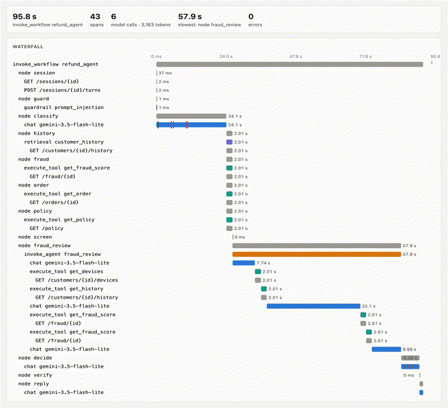

# 09 · Spans

Part 1 ended with questions nobody could answer: why did that run take 93 s, where did 55 s go in the policy search, why was one stream 12 s late? The agent printed totals; it never said what happened *inside*. This stage gives it a camera: **every run is a trace, and every step, model call, tool call, memory read, hand-off and guardrail is a span**, written by hand with the OpenTelemetry SDK ([`agentkit/telemetry.py`](../agentkit/telemetry.py)).



*The grey-zone refund ($12, fraud score 0.58) from a real run, replayed: spans appear as they started, and grow to their real length. The model call at the top carries red marks: a daily-quota 429, a fallback, two 503s. The fraud-review sub-agent (orange) spends 58 of the run's 96 seconds, mostly in its second model call. Frames captured from the viewer's replay mode (`/ui/traces?replay=<trace id>`, [`viz/capture.js`](../viz/capture.js)) and assembled with ffmpeg.*

## The shape of a trace

The span names and attributes follow the **OpenTelemetry GenAI semantic conventions**. Those now live in their own repository (`open-telemetry/semantic-conventions-genai`); every attribute there is still *Development*, the repo has no release yet, and several names changed in 2026 (`gen_ai.system` is now `gen_ai.provider.name`, cache-creation tokens are now `cache_write`). We follow the current `main`, as of 2026-10-20.

| Span | Kind | What it records |
|---|---|---|
| `invoke_workflow refund_agent` | INTERNAL | the run: run id, customer, session (`gen_ai.conversation.id`), prompt set and agent version, the decision, failures, guardrail flags |
| `node <name>` | INTERNAL | one graph step (our own name; the conventions have no "graph node") |
| `chat <model>` | CLIENT | one model call: `gen_ai.request.model` and the `gen_ai.response.model` that actually answered, tokens in/out/reasoning/cached, finish reason, temperature, time to first chunk when streamed. Events for every 429, 503, fallback and **our own rate limiter's wait** |
| `execute_tool <name>` | INTERNAL | a tool: the graph's lookups, and the tools a sub-agent's model chose (`gen_ai.agent.name` says whose) |
| `retrieval customer_history` | CLIENT | a read from memory (`gen_ai.data_source.id`) |
| `invoke_agent <name>` | INTERNAL | a sub-agent (`fraud_review`, `policy_expert`, `customer_support`); its model calls and tools nest under it |
| `guardrail <check>` | INTERNAL | input and output checks: verdict, by whom, evidence (our own name) |
| `GET /orders/{id}` … | CLIENT | every HTTP call to the platform, with method, route and status: what an HTTP auto-instrumentation would add |

Three things took care:

- **Context across threads.** LangGraph runs parallel nodes on worker threads, and OpenTelemetry's "current span" lives in a context variable that doesn't follow on its own. The root span's context is handed to every node explicitly (`TracedGraph.roots`), and the session id travels as **baggage** so a span deep in a sub-agent can still say which conversation it belongs to.
- **Waiting for a person is not an error.** LangGraph pauses with an exception (`GraphInterrupt`); left alone, every paused run would show a red span.
- **A wait of days is two traces, linked.** The $640 run pauses for the manager. Its trace ends there. When the manager answers (here in a second process, it could be Thursday) the resumed run starts **a new trace with a span link** to the one that paused, from the `traceparent` stored in the checkpoint. A single trace three days long breaks most backends and every tail sampler.

Message bodies (`gen_ai.input.messages`, `gen_ai.output.messages`, tool arguments and results) are **opt-in**, as the conventions say: off unless `OTEL_INSTRUMENTATION_GENAI_CAPTURE_MESSAGE_CONTENT=SPAN_ONLY`. Stage 11 is about why.

The viewer at **http://127.0.0.1:8710/ui/traces** lists traces and draws each one as a waterfall, coloured by kind (model, tool, memory, sub-agent, guardrail), with every attribute and event a click away. Spans reach it through an exporter that posts JSON to the platform; stage 10 replaces that with real OTLP and a collector.

## Run it

```bash
make platform
python 09-spans/run.py             # grey | wait | where, then open http://127.0.0.1:8710/ui/traces
```

## Real run (Gemini free tier, 2026-10-20)

**One run, 43 spans.** The grey-zone refund took 95.8 s. Its trace answers what part 1 couldn't:

```
  0.04s   node classify                               24.07s
  0.05s     chat gemini-3.5-flash-lite                24.07s  127+46 tokens; waited 4.9 s for our rate limiter;
                                                              daily_quota_exhausted; fallback; server_error_503 …
 26.13s   node fraud_review                           57.93s
 26.13s     invoke_agent fraud_review                 57.93s
 26.17s       chat gemini-3.5-flash-lite               7.74s  379+42 tokens
 33.90s       execute_tool get_devices                 2.01s
 35.91s       execute_tool get_history                 2.01s
 37.92s       chat gemini-3.5-flash-lite              32.12s  536+46 tokens
 70.05s       execute_tool get_fraud_score             2.01s   (C-5520)
 72.06s       execute_tool get_fraud_score             2.01s   (C-6012)
 74.07s       chat gemini-3.5-flash-lite               9.99s  686+106 tokens
 84.06s   node decide                                  6.28s
 90.34s   node reply                                   5.48s
 90.34s     chat gemini-3.5-flash-lite                 5.47s  first chunk 5.18 s
```

The first call's 24 s: 3.5 Flash-Lite's daily quota was gone, the client fell back to 3.1, and that hit two 503s. One call inside the sub-agent took 32 s on its own with no retry at all: a slow answer, now *visible* as one. The four lookups run side by side in 2.01 s.

**The wait.** The $640 run paused in process A (trace `434b675d…`, 27 spans, ending at `node approval`). The manager approved. Process B resumed it as trace `4420adaa…`, linked to the first ("resumed after waiting for the operations manager"), and refunded $640.

**Where six ordinary runs spend their time** (self time of each span, summed by kind; parallel steps overlap, so the parts add up to more than the whole):

| | seconds | share of 116 s |
|---|---|---|
| the model answering | 78.2 | 68% |
| platform HTTP calls | 48.3 | 42% |
| **waiting for our own rate limiter** | 23.0 | **20%** |
| back-off after 429/503 | 2.0 | 2% |
| our own code | 0.1 | 0% |

A fifth of every run was the agent waiting for *itself*: the client-side limit that keeps us under the free tier's requests per minute. In part 1 that time was invisible, and was blamed on "the model".

Full output: [`output.txt`](output.txt).

## Where it breaks

- **The spans go straight from the agent to one viewer.** There's no standard wire format, no buffering if the viewer is down, no way to send the same spans to two places, and no numbers over time. A trace explains one run; it doesn't say "p95 went up at 21:00". Next: [10 · the data path](../10-data-path/).
- The viewer stores everything forever, including the customer's id on every root span. Stage 11 deals with that.
