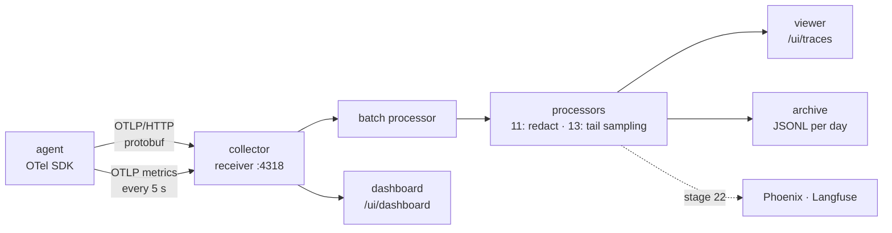
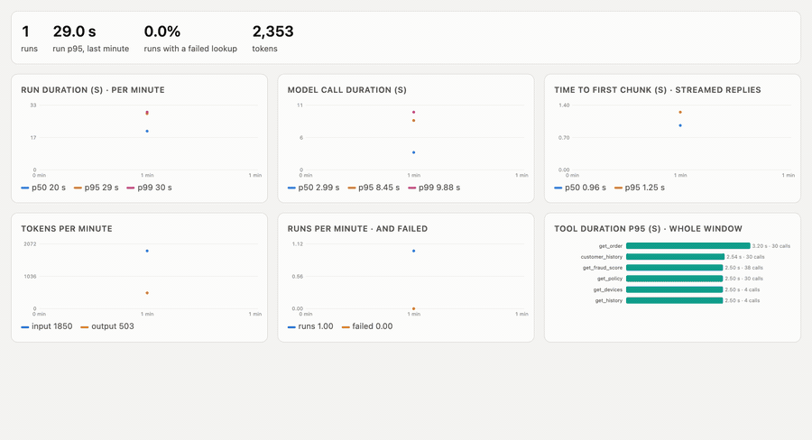

# 10 · The data path

Stage 09's spans went straight from the agent to one viewer, as JSON, in a format we made up. That breaks as soon as there's a second destination, a backend that's down, or a question about *time* ("did p95 go up at 21:00?"), which one trace can't answer.

Now telemetry travels the way it does in production:



- **The agent speaks OTLP**, the OpenTelemetry protocol, with the standard exporters (`opentelemetry-exporter-otlp-proto-http`). It no longer knows who receives its spans.
- **A collector sits in between** ([`services/collector.py`](../services/collector.py)): it receives OTLP, decodes the protobuf, batches (every second or 200 spans), runs processors, and fans out to exporters, so one destination failing doesn't stop the others. It counts every hop (`GET /stats`). We wrote a small one to see what it does; in production you'd run the OpenTelemetry Collector (`otelcol-contrib`), whose tail-sampling processor doesn't exist in the SDKs at all (stage 13).
- **Metrics travel next to the spans.** The agent records the GenAI metrics with the names, units and bucket boundaries from the conventions:

| Metric | Type | What it is |
|---|---|---|
| `gen_ai.invoke_workflow.duration` | histogram (s) | a run, by outcome and whether a lookup failed |
| `gen_ai.client.inference.duration` | histogram (s) | a model call, by requested and answering model |
| `gen_ai.client.inference.time_to_first_chunk` | histogram (s) | streamed replies |
| `gen_ai.client.inference.usage.input_tokens` / `.output_tokens` | counters | tokens, by model |
| `gen_ai.execute_tool.duration` | histogram (s) | each tool |

  Careful with tutorials: these names are from the conventions' `main` branch, which renamed `gen_ai.client.token.usage` (now per-direction counters) and `gen_ai.client.operation.duration` (now `inference.duration` for model calls) in 2026. Released libraries still emit the old ones.

- **The dashboard** (http://127.0.0.1:8710/ui/dashboard) turns the metric points into p50/p95/p99 per minute, tokens per minute, runs and failures, and tool latency, and shows the data path with live counts.



*Ten minutes of real traffic (30 requests) replayed: run, model-call and first-chunk percentiles per minute, tokens, runs. Frames from the dashboard's replay mode (`/ui/dashboard?replay=1`, [`viz/capture.js`](../viz/capture.js)), assembled with ffmpeg.*

## Run it

```bash
make platform                # terminal 1
make collector               # terminal 2
GEMINI_RPM=12 python 10-data-path/run.py 30
```

## Real run (gemini-3.1-flash-lite, 2026-10-20)

30 requests in 9.9 min, 3 workers, **30/30 right** ([`data/`](data/)).

**The data path, counted:** 175 OTLP requests carried **1,045 spans** into the collector, in 166 batches; 1,045 reached the viewer and 1,045 the archive, none failed or queued; **472 metric points** reached the dashboard.

**What the dashboard computed vs the exact numbers from the run log:**

| | metric (histogram) | run log (exact) |
|---|---|---|
| runs | **37** | 30 |
| run p50 | 32.7 s | 38.2 s |
| run p95 | 83.0 s | 93.9 s |
| model call p50 / p95 / p99 | 2.70 / 8.16 / 19.97 s | — |
| first chunk p50 / p95 | 2.43 / 7.68 s | — |
| tokens | 49,227 | 49,227 |

What the numbers say:

- **"Runs" means different things in different places.** The metric counted 37 runs where the log has 30: the seven runs that waited for the manager are two traces each (paused, then resumed), and each records a duration. Neither number is wrong; the dashboard has to say which one it shows.
- **Percentiles from a histogram are estimates.** All a histogram keeps is a count per bucket, and the conventions' buckets for a run are 30, 60, 120 s. A p95 somewhere between 60 and 120 s gets interpolated to 83 s; the exact value was 93.9 s. Tokens, a counter, match to the token. Choose buckets where your SLO is (stage 14).
- **A p95 over three runs is noise.** Per minute, the run p95 jumps between 55 and 111 s because one slow grey-zone case lands in a minute or doesn't. Percentiles need volume (stage 13).
- **Model calls: p50 2.7 s, p99 20 s.** One minute's p95 spiked to 28.7 s, the minute with a 503 retry: the metric shows *that* something happened, the trace for that minute shows *what*.
- Three injected 500s were all absorbed by retries: 0% failed lookups.

Full output: [`output.txt`](output.txt).

## Where it breaks

Every span now carries the customer's id, and with message capture on, their whole message, to the viewer *and* an archive that never forgets. One customer pasting a phone number or a card into the chat puts it in three places. Next: [11 · privacy](../11-privacy/).
