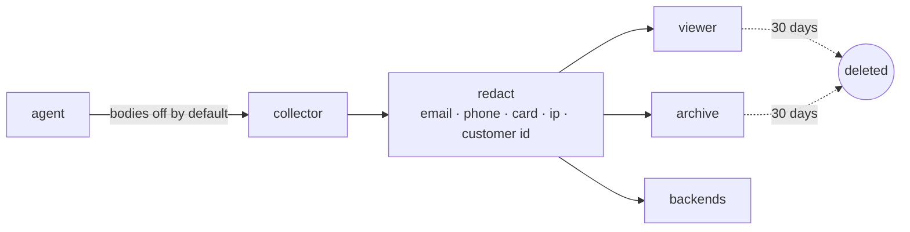
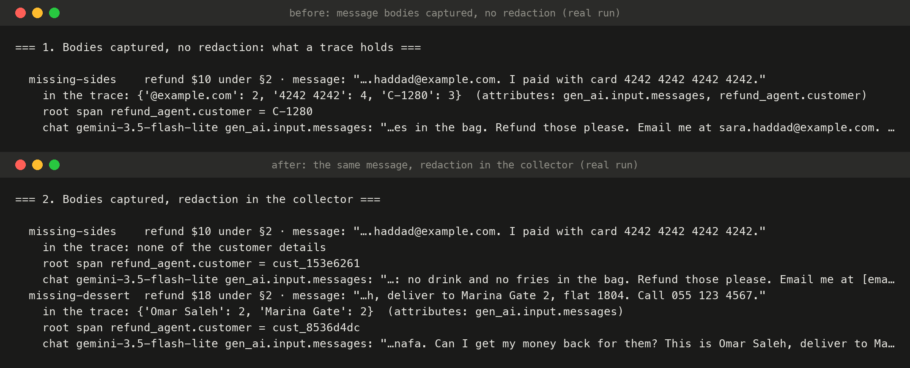

# 11 · Privacy

Observability copies data. Every span the agent writes travels to the collector, then to the viewer, an archive, and soon two more backends. If a customer pastes a phone number into the chat, and message capture is on, that phone number is now in five places, kept forever, readable by anyone who can open a dashboard. Stage 10 made that path work; this stage decides what's allowed to travel on it.

Three controls, from the most effective to the last line of defence:

1. **Don't capture message bodies unless you need them.** The GenAI conventions make `gen_ai.input.messages`, `gen_ai.output.messages`, system instructions and tool arguments and results **opt-in**: off by default, on with `OTEL_INSTRUMENTATION_GENAI_CAPTURE_MESSAGE_CONTENT=SPAN_ONLY`. The spans still say what happened (model, tokens, timings, decisions); they don't carry what the customer typed.
2. **Redact in the collector** ([`services/redact.py`](../services/redact.py)), before any exporter sees a span: emails, phone numbers, card numbers (13–19 digits that pass the Luhn check, kept as `[card ****4242]`), IP addresses, inside every attribute, event and link, including the JSON inside message attributes. Customer ids become a **pseudonym**, a keyed hash (`C-7740` → `cust_a0d66a1e`): every span of one customer still has the same value, so traces can be grouped and joined to ratings, but the id can't be read back without the key. One processor in the collector covers every service that sends to it; the OpenTelemetry Collector has the same idea (`redaction`, `transform` processors).
3. **Keep traces for a limited time.** The platform deletes spans and metric points older than `RETENTION_DAYS` (30 by default) every hour (`POST /admin/retention`), and the collector's archive drops daily files older than that (`POST /retention`).



## Run it

```bash
make platform ; make collector
python 11-privacy/run.py
```

## Real run (Gemini free tier, 2026-10-20)

Three refund requests, each with made-up personal details pasted in: a phone number; an email and a card number; a name, a street address and another phone number.



*The real terminal output of scenes 1 and 2 ([`output.txt`](output.txt)), rendered with [`viz/terminal.py`](../viz/terminal.py): nothing retyped. "In the trace" counts how often each detail appears anywhere in the run's spans, read back from the viewer.*

| Scene | Bodies | Collector | What reached the viewer and the archive |
|---|---|---|---|
| 1 | captured | no processor | **everything**: the phone (twice), the email (twice), the card (four times), the name, the address, and the real customer id on 3 spans per run |
| 2 | captured | `redact` | phone → `[phone]`, email → `[email]`, card → `[card ****4242]`, customer → `cust_a0d66a1e`. **The name and the address went through** ("This is Omar Saleh, deliver to Marina Gate 2") |
| 3 | off (default) | `redact` | none of the customer's details; the root span still says which (pseudonymous) customer it was, the decision, the cost and every timing |
| 4 | retention | | 9 traces → 3: 196 spans and 619 metric points older than scene 3 deleted |

What the run taught:

- **Redaction is a net with holes.** Patterns catch what has a shape (an email, a card that passes Luhn, a phone). A name or an address in free text has no shape. The only complete answer is not capturing the body in the first place: scene 3 leaked nothing and lost nothing a dashboard needs.
- **The pseudonym keeps traces useful.** C-7740 became `cust_a0d66a1e` in scene 2 *and* scene 3: the same customer is still one customer across runs, ratings and alerts.
- **The first version over-redacted.** Its counters reported dozens of "IP addresses": the `server.address` (127.0.0.1) on every HTTP span. Scrubbing it would have hidden *where calls went*, which is exactly what debugging needs. Infrastructure fields (server address and port, route, method, status, model names) are now never scrubbed, and a test holds that line.
- **Retention is a delete, so try it on purpose.** The cut-off removed scene 1 and 2's traces along with their unredacted copies. If an old trace still holds something it shouldn't, waiting out the retention window is the remedy; there's nothing to clean by hand.

Full output: [`output.txt`](output.txt).

## Where it breaks

Every span now carries what it cost, in tokens. Nobody adds it up. A customer, a case, a day: nothing says what they cost, nothing stops a run that keeps calling the model, and Gemini's discount for repeated prompts (cached tokens) is never measured. Next: [12 · cost](../12-cost/).
