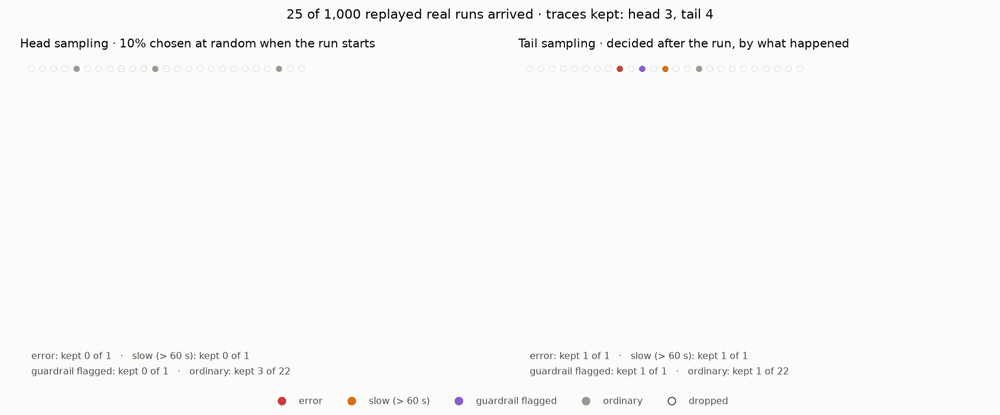

# 13 · Sampling

A run of the refund agent is 25 to 45 spans. At a few hundred runs an hour that's fine; at a few hundred a minute, keeping every span of every run is the most expensive part of observability, and most of it describes runs where nothing happened. **Sampling** keeps some traces and drops the rest. *Which* ones is the whole question.

- **Head sampling** decides when a trace starts, in the SDK, from the trace id alone (`TraceIdRatioBased(0.1)`: keep 10%). Cheap and simple; the dropped spans never leave the process. It's also blind: it can't know yet whether this run will fail.
- **Tail sampling** decides when the trace is finished, in the collector, from what happened. It has to hold every span of a trace until the trace is complete, which costs memory and only works where all of a trace's spans arrive in one place. No SDK can do it: in the OpenTelemetry world it's the Collector's `tail_sampling` processor, in the contrib build only.

Our collector now has a tail sampler ([`services/sampling.py`](../services/sampling.py)): spans wait per trace until the root span arrives (it ends last), then the trace is kept if **any span has an error**, the run took **over 60 s**, a **guardrail flagged** it or a **budget or quota stop** ended it, or it falls in a **5% baseline** chosen by trace id (stable: the same trace always gets the same answer).

## A thousand runs on a free tier

Volume is exactly what the free tier can't give: both Flash-Lite models stopped at 500 requests a day in stage 12. So this stage **replays recorded real runs** ([`agentkit/span_replay.py`](../agentkit/span_replay.py)): the 75 complete runs the collector archived in stages 10–12, re-sent over OTLP as new traces with fresh ids and shifted timestamps, every span marked `replay.of` with the trace it copies. The timings, tokens, errors and decisions are the real ones; only the ids and clocks are new. The mix is stated, not discovered: 85% ordinary, 6% flagged, 4% slow, 5% errors.



*Each dot is one of the 1,000 replayed runs, in arrival order: its colour is what the run was, filled if its trace was kept, a faint ring if dropped. Left, head sampling at 10%; right, tail sampling. Drawn from the stage's own output ([`data/sampling.json`](data/sampling.json)) with [`viz/sampling.py`](../viz/sampling.py).*

## Run it

```bash
make platform ; make collector
python 13-sampling/run.py           # replays the archive of real runs from stages 10-12
```

## Real run (2026-10-20)

1,000 replays (860 ordinary, 47 errors, 52 flagged, 41 slow): 26,824 spans produced.

| | Head sampling, 10% | Tail sampling |
|---|---|---|
| traces stored | 77 | 178 |
| spans stored | 2,044 (8%) | 5,118 (19%) |
| errors kept | **4 of 47** (9%) | **47 of 47** |
| slow runs kept | 2 of 41 | 41 of 41 |
| guardrail-flagged kept | 1 of 52 | 52 of 52 |
| ordinary runs kept | 70 of 860 | 38 of 860 (the 5% baseline) |
| error rate measured from stored traces | 5.2% (true: 4.7%) | **26.4%** (true: 4.7%) |

What the numbers say:

- **Head sampling throws away the traces you need.** 43 of the 47 failed runs left no trace at all. When someone asks "why did this customer's refund fail?", nine times in ten the answer is "we sampled it out".
- **Tail sampling keeps every interesting run for 2.5 times the storage of head sampling** and a fifth of keeping everything: 5,118 spans instead of 26,824.
- **Never compute a rate from tail-sampled traces.** The stored traces say 26% of runs fail; the truth is 4.7%. Tail sampling is biased by design: it keeps what's unusual. Head sampling's 5.2% is an honest (if noisy) estimate. **Rates come from metrics**, which the SDK records for every run before any sampling (stage 10): the dashboard's error rate never saw the sampler.
- The baseline matters: without the 38 ordinary traces, there'd be nothing normal to compare a slow run with.

Full output: [`output.txt`](output.txt).

## Where it breaks

We can now see every failure and keep the evidence. But nobody is *watching*. A run fails at 21:00 and the trace is there, faithfully, until someone happens to open the dashboard on Thursday. Next: [14 · alerts](../14-alerts/).
