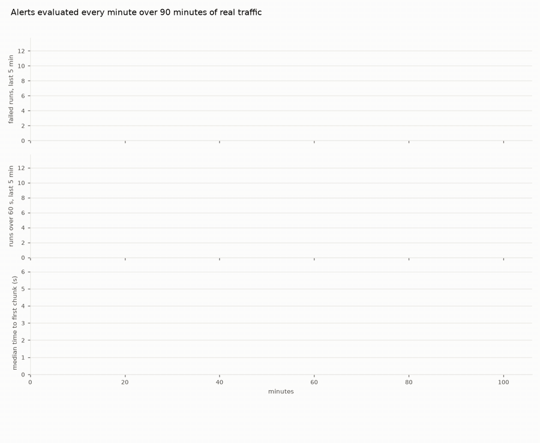

# 14 · SLOs, alerts and drift

Everything so far waits for someone to look. This stage makes the system tell *us*: a few rules over the metrics, evaluated every minute, that fire when something is wrong and resolve when it isn't ([`services/alerts.py`](../services/alerts.py)).

| Rule | Kind | Fires when |
|---|---|---|
| availability fast burn | SLO burn rate | the objective "99% of runs end without a failed lookup, a crash or a safe stop" is being burned at **14.4×** over both the last 5 minutes and the last hour |
| latency fast burn | SLO burn rate | "90% of runs finish within 60 s" is burned at **6×** over 5 and 30 minutes |
| first-chunk drift | drift | the distribution of time to first chunk moves away from the first 15 minutes: **PSI > 0.25** |
| spend rate | threshold | model spend above $0.30 an hour |

**Why burn rates.** An SLO leaves an *error budget*: 99% means 1% of runs may fail. The burn rate is how fast that budget goes: a window where 14% of runs fail burns it at 14×. Alerting on burn rate over two windows at once (the SRE workbook's multiwindow alert) means one bad minute doesn't page anyone, and a real incident pages within minutes. **Why PSI.** Drift isn't failure: nothing errors, the numbers just change shape. The population stability index compares two histograms bucket by bucket; above 0.25 the distribution has moved.

## Real traffic, real incidents

No incident was staged for this stage. The **210 real runs** of stages 07, 08, 10 and 12 become the metric points the SDK would have recorded for them, **at the times they actually happened** ([`history.py`](history.py)), and the engine is evaluated minute by minute over those 90 minutes as if it had been running. Three things really happened in that window:

- **A** (0:21) Flash-Lite 3.5 ran out of daily quota and the fallback, 3.1 Flash-Lite, silently took over;
- **B** (0:35) the stage 07 batch was overloaded: one customer queued 14 minutes;
- **C** (1:25) both models ran out of quota and 14 runs crashed within 6 minutes.



*Failed runs, runs over 60 s and the median time to first chunk, per trailing 5 minutes, from the real run logs of stages 07–12; yellow bands are minutes an alert was firing; A, B, C are the events above. Drawn from the stage's output ([`data/alerts.json`](data/alerts.json)) with [`viz/alerts.py`](../viz/alerts.py).*

## Run it

```bash
make platform
python 14-alerts/run.py
```

## Real run (2026-10-20)

```
  0:28  FIRING    first-chunk drift        {'psi': 0.29, 'n': 47}
  1:32  FIRING    availability fast burn   {'burn_short': 100.0, 'burn_long': 15.0}
  1:36  RESOLVED  availability fast burn   {'burn_short': 0.0, 'burn_long': 17.0} after 4 min
  1:39  RESOLVED  first-chunk drift        {'psi': None, 'n': 3} after 71 min
```

Over the whole window: **91.4% of runs without a failure** against a 99% objective (9× the error budget), and **76.7% within 60 s** against 90% (2.3×).

What the run taught:

- **The drift alert caught the silent model switch in 7 minutes.** Nothing failed, accuracy didn't drop, no error was logged: the median time to first chunk went from about 1 s to 3–6 s. Only the shape of a distribution said "something changed at 0:21". In part 1 the same switch went unnoticed for a whole batch.
- **The availability alert caught the quota crash in 7 minutes** (both windows over 14.4×: 100× and 15×).
- **It "resolved" because traffic stopped, not because anything was fixed.** Four minutes later the 5-minute window was empty, its burn rate 0, and the alert cleared, while the hour window still burned at 17×. The drift alert resolved the same way, on too little data. An alert that resolves on silence needs a "no data" state of its own.
- **The latency alert never fired, and it should have.** Customers waited up to 14 minutes during B, but the SLO measures *run time*, and the queue happens before the run starts. 23% of runs were over a minute; no 5-minute window burned at 6×. The SLO measured what was easy, not what customers feel. The fix is an SLO on the customer's wait (message to first word), which needs the queue time on the root span.
- The spend rule stayed quiet: about $0.12 an hour at list price.

Full output: [`output.txt`](output.txt).

## Where it breaks

An alert says *that* something is wrong. Then someone has to find the run, see what happened in it, try a fix on exactly that run, and compare before and after. Today that means scrolling the viewer. Next: [15 · debugging](../15-debugging/).
