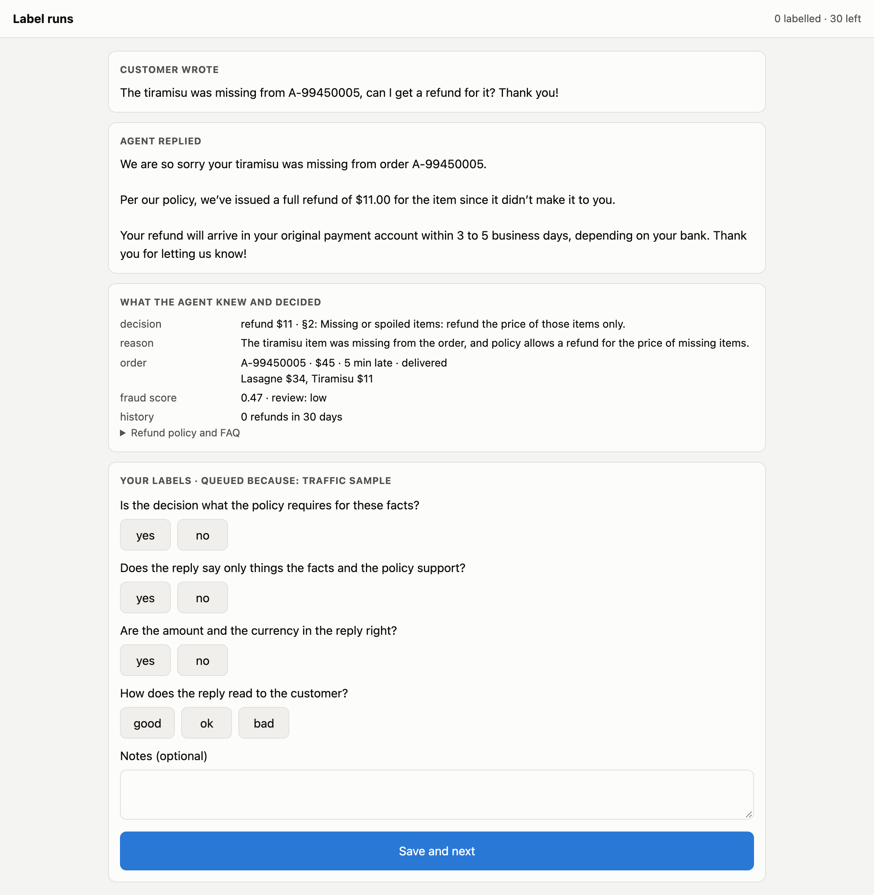

# 17 · Annotation: the labels a judge is measured against

Stage 18's checks read what's certain from a trace. A lot of what makes a reply good isn't certain: is everything it says supported, does it read well to an upset customer? Before a model can judge that (stage 19), there has to be something to judge it *against*: runs with known-good labels.

**The queue** ([`services/app.py`](../services/app.py), `/annotations/…`, page [`/ui/annotate`](../services/ui/annotate.html)). Runs are queued with *why* (a sample of traffic, every guardrail flag, every hand-written case), and each item is a **snapshot frozen when the run ended** ([`agentkit/annotation.py`](../agentkit/annotation.py)): the message, the reply, the decision and its reason, the order, the fraud score, the history, the policy and FAQ. Traces don't carry message bodies (stage 11), so the snapshot lives with the platform's data, where access to customer messages is already controlled, and links to its trace by run id.



*The queue page on a real run. Screenshot with headless Chrome ([`viz/screenshot.js`](../viz/screenshot.js)).*

Four questions per run, the same ones the judge will answer: is the decision what the policy requires, does the reply say only what the facts and policy support, are the amount and currency right, how does it read (good / ok / bad).

## Run it

```bash
make platform ; make collector
python 17-annotation/run.py                   # 30 real runs, queued with why
python 17-annotation/run.py --report          # what the labels say
```

## Real run (gemini-3.5-flash-lite, 2026-10-20 and 2026-10-22)

30 runs queued: the 18 hand-written cases and 12 traffic variants; 7 of them because a guardrail fired ([`output.txt`](output.txt)).

**How these labels were made.** No person labelled them. The two kinds of question were labelled apart, so they can be reported apart ([`labels/RUBRIC.md`](labels/RUBRIC.md), [`labels/reference.jsonl`](labels/reference.jsonl)):

- **Factual questions, from the known right answers.** Every run is a case or a variant of one, and its outcome was checked against the case's expected decision when it was queued. Amount and currency come from the decision and the reply text. Anyone checking the same records gets the same labels.
- **Judgement questions, from a second model with a written rubric.** Grounding and tone were labelled by Claude, a different model from the judge (Gemini), in one pass before the judge ran. Model-against-model agreement is weaker evidence than a person's labels; a person-labelled set is the next step (`--annotator <name>` reads one).

| question | yes / good | no / ok |
|---|---|---|
| decision correct | 30 | 0 |
| amount and currency right | 29 | 1 (riyals, corrected after) |
| reply grounded | **4** | **26** |
| tone | 27 good | 3 ok |

What the labels found:

- **26 of 30 replies said something nobody told them.** 17 refund replies promised the money "in 3 to 5 business days"; the FAQ says 5 to 10 working days. 8 credit replies said the credit was usable "right now"; the FAQ says within an hour. One promised a rude rider "won't happen again". The reply prompt never sees the FAQ ([`agentkit/judgments.py`](../agentkit/judgments.py)), so it fills the gap with what replies usually say. Every decision behind them was right.
- **None of stage 18's checks could see it.** Amounts, counts and payments were all fine. The trouble was in the words.
- **The three "ok" replies were all refusals**: "security policies" and a form-letter sign-off, a refusal with no reason, a refusal explained only as "§9". Right decisions, read coldly.

Full report: [`output-report.txt`](output-report.txt).

Fixed since: the reply prompt gets the FAQ entry for its decision, and a deterministic check guards the timelines in the release gate ([20](../20-online-evals/#a-second-curated-case-timelines-the-faq-doesnt-give-2026-10-22)); the snapshot records the manager's approval ([19](../19-judge/)).

## Where it breaks

Labelling 30 runs is an afternoon; labelling every run is impossible. A model that answers the same four questions could read every run, but only if it agrees with the labels. Next: [19 · the judge](../19-judge/), and how far to trust it.
