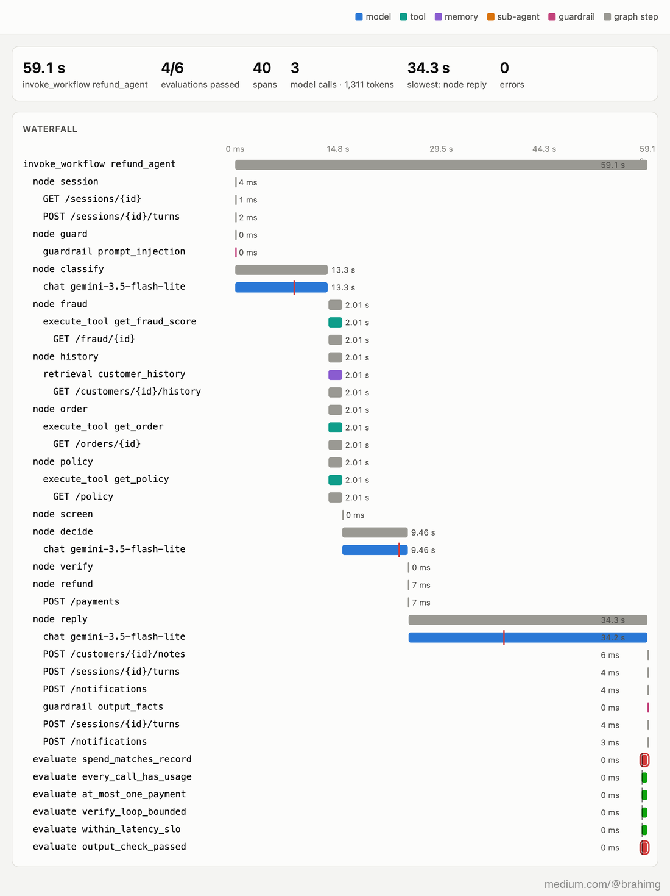

# 18 · Evals: the referee's rulebook

Part 2 built the camera: we can see what every run did. Part 3 builds the referee: something that says whether it was *good*. The first kind of referee needs no judgement at all. Some rules are certain from the trace alone, and checking them is just code ([`evals/checks.py`](../evals/checks.py)):

| Check | Fails when |
|---|---|
| `spend_matches_record` | the cost the model spans add up to isn't the cost the run reported: the bill doesn't match the trace |
| `every_call_has_usage` | a model call that got an answer recorded no tokens: an instrumentation gap |
| `no_payment_after_a_failed_lookup` | a lookup failed and the run still moved money |
| `at_most_one_payment` | a run called the payment service twice |
| `verify_loop_bounded` | `decide` ran more than 3 times |
| `within_latency_slo` | the run took more than 60 s (a run waiting for the manager is exempt) |
| `under_budget` | the run's model spend passed $0.003 |
| `sub_agents_finished` | a sub-agent hit its step limit without a result |
| `output_check_passed` | the output guardrail flagged the reply |

Each check is a function of the run's spans (and, for the spend, its record from the traffic log), returning pass, fail, or "doesn't apply". Because they read traces, they work on any run that was ever recorded, after the fact, without running the agent again.

**Results go back into the trace.** The GenAI conventions define an event for this, `gen_ai.evaluation.result` (`gen_ai.evaluation.name`, `score.value`, `score.label`, `explanation`), meant to hang off the span it judged. A finished span can't take new events, so each result travels on a short span of its own, `evaluate <check>`, created as a child of the run's root span ([`evals/emit.py`](../evals/emit.py)). It lands in the same trace, next to what it judged:



*A real run from stage 10 (59 s, refund $55 to an Arabic message), restored from the collector's archive into the viewer, with the six checks that applied written back into its trace: four passed (green), two failed (red): its spend can't be reconciled, and its reply named riyals. Screenshot of the trace viewer ([`viz/screenshot.js`](../viz/screenshot.js)).*

## Run it

```bash
make platform ; make collector
python 18-evals/run.py              # checks on every archived real run, results into their traces
python 18-evals/run.py --cases      # the case set, live: the offline eval
```

## Real run (2026-10-20)

**Every archived real run** from stages 10–12 (75 runs; 46 joined to their traffic-log record):

| check | pass | fail |
|---|---|---|
| spend_matches_record | 3 | **43** |
| every_call_has_usage | 61 | 0 |
| no_payment_after_a_failed_lookup | – | – (no such run) |
| at_most_one_payment | 41 | 0 |
| verify_loop_bounded | 51 | 0 |
| within_latency_slo | 48 | **17** |
| under_budget | 11 | 0 |
| sub_agents_finished | 4 | 0 |
| output_check_passed | 43 | **6** |

328 results written into their traces. What the referee found:

- **43 runs whose spend the trace can't account for.** Not overcharges: the cost attribute (`gen_ai.usage.cost`) only arrived in stage 12, so stage 10 and 11 traces add up to $0 against a reported $0.001–0.002. The check did exactly its job: a bill that the trace can't explain is a bill nobody can audit. The three stage-12 runs reconcile to the micro-dollar.
- **6 replies named the wrong currency**: riyals (ريال) in Arabic replies, and once **AED** in an English one. The output guardrail already flagged them at run time; now they're counted, per run, forever.
- **17 runs over 60 s**, mostly the grey-zone reviews and the slow streams.
- **The first version of a check was wrong.** `every_call_has_usage` first failed 16 runs: model calls the meter had refused, or that failed with no answer, have no tokens to record. A check needs the same care as the code it checks; it now only counts calls that got an answer.
- Nothing paid twice, nothing paid after a failed lookup, every verify loop stopped within 3 tries.

**The case set, live** (`--cases`, after the free quota reset): **18/18 correct**, 61 model calls, $0.0174 at list price. The offline eval is the case set run as a test: the same 18 messages, the expected decision for each, and nothing to judge but the outcome.

Full output: [`output.txt`](output.txt).

## Where it breaks

Code can check what's certain: amounts, counts, statuses. It can't read. Whether "the refund covers the order total; tips go to the rider" is *grounded*, whether a refusal was explained kindly, whether the decision was the right call in a case no rule covers: that takes judgement. A person can give it, slowly (stage 17). Next: [19 · the judge](../19-judge/), a model that reads like that person, and a test of how far to trust it.
