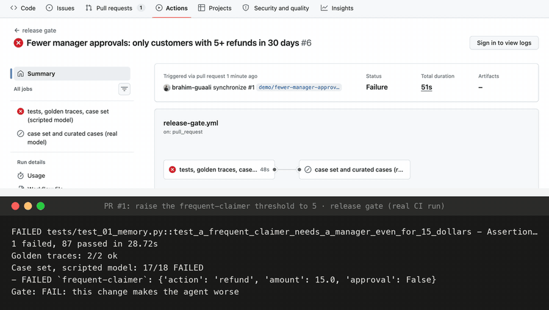

# 21 · The release gate

Every check so far ran *after* something shipped. A gate runs *before*: on every pull request, GitHub Actions runs the referee, and a change that makes the agent worse goes red and doesn't merge ([`.github/workflows/release-gate.yml`](../.github/workflows/release-gate.yml), [`evals/gate.py`](../evals/gate.py)).

The gate has three layers, cheapest first:

| Layer | Runs | Catches |
|---|---|---|
| **Golden traces** | the deterministic checks of stage 18 on two stored real runs ([`evals/golden/`](../evals/golden/)) | instrumentation that broke: tokens no longer recorded, a payment span gone |
| **Case set, scripted model** | all 18 cases through the real graph, platform and verifier, with a model that gives each case the right judgments | the *code* getting worse: a routing rule, a threshold, a verifier check removed. The model is fixed, so nothing else can be the cause |
| **Case set and curated cases, real model** | the cases and the curated cases of stage 20 on Gemini, against a stored baseline ([`evals/baseline.json`](../evals/baseline.json)): accuracy may not drop, curated cases must pass, cost and slow runs within limits | prompt and model changes |

The first two need no API key and run on every push and PR. The third needs the Gemini key as a repository secret; without it the job says so and skips (it runs locally with `python -m evals.gate --live`).

## A well-meant change, caught

To see it work, a real pull request: [#1 "Fewer manager approvals: only customers with 5+ refunds in 30 days"](https://github.com/brahim-guaali/agent-observability-from-first-principles/pull/1). Managers are busy, the threshold goes from 3 to 5. It reads like a reasonable tweak. Policy §8 still says three.



*The real CI runs of PR #1 ([red](https://github.com/brahim-guaali/agent-observability-from-first-principles/actions/runs/39343518759), [green](https://github.com/brahim-guaali/agent-observability-from-first-principles/actions/runs/39343679243)): the GitHub run page (screenshot, signed out) above the gate's own output from that run, rendered with [`viz/terminal.py`](../viz/terminal.py).*

```
FAILED tests/test_01_memory.py::test_a_frequent_claimer_needs_a_manager_even_for_15_dollars
1 failed, 87 passed in 28.72s
Golden traces: 2/2 ok
Case set, scripted model: 17/18 FAILED
- frequent-claimer: {'action': 'refund', 'amount': 15.0, 'approval': False}
Gate: FAIL: this change makes the agent worse
```

A customer with four refunds this month would have had $15 refunded without a manager seeing it. Reverting to 3 turned it green: 88 tests, 2/2 golden traces, 18/18 cases. The PR was closed, unmerged.

## Run it

```bash
make test && python -m evals.gate            # what CI runs on every PR
python -m evals.gate --live                  # plus the real-model layer (needs GEMINI_API_KEY and `make platform`)
```

## Real runs (GitHub Actions, 2026-10-20)

| Run | Tests | Golden traces | Case set (scripted) | Live | Time |
|---|---|---|---|---|---|
| main, the gate added | pass | 2/2 | 18/18 | skipped (no secret) | 56 s |
| PR #1, threshold 3 → 5 | **1 failed** | 2/2 | **17/18** | skipped | 51 s |
| PR #1, back to 3 | 88 passed | 2/2 | 18/18 | skipped | 1 m 13 s |

What CI taught on the way:

- **The first CI run found a flaky test.** The stage 07 race test (two runs, one order, at the same moment) passed on the laptop every time and failed on GitHub's runner. On a slower machine, the second run sometimes reads the customer's history *after* the first has paid, and refuses under §7 instead of reaching the payment. Both outcomes are right; the test had assumed one. It now asserts what matters: exactly one payment, the other run replayed or refused.
- **Gates should report all their layers.** At first the gate step didn't run once a unit test had failed, so the PR showed one red line and no gate verdict. It now runs either way: the unit test and the scripted case set both caught the change, in their own words.
- **Never lower the baseline to make a PR pass.** It moves up when the agent gets better (the file says so).

Full output: [`output.txt`](output.txt).

## Where it breaks

Everything is our own: the viewer, the dashboard, the collector, the evals. That's how you learn what each piece does, but in production you'd rather not maintain a trace store. The spans are standard OpenTelemetry, so they should work in real observability products unchanged. Next: [22 · platforms](../22-platforms/).
