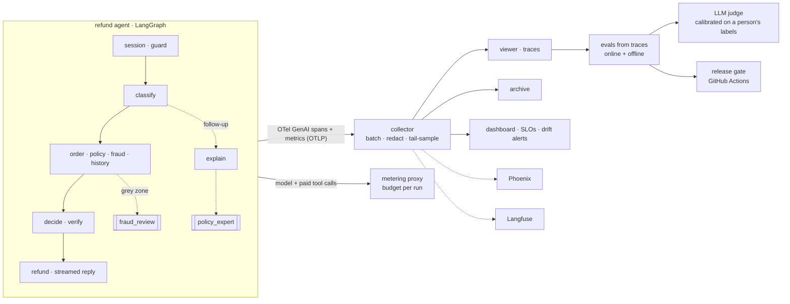

# Agent observability from first principles

A course in runnable code. We take a real refund agent from a food-delivery app, make it behave like production (memory, conversations, failing services, traffic, customer feedback), then give it a **camera** (traces, cost, a budget meter) and a **referee** (evals, an LLM judge checked against a person, a release gate in CI).

- **Observability is the camera:** every model call, tool call and memory read leaves a span with its timing, tokens and cost, so you can see what a run did and what it spent.
- **Evals are the referee:** checks in code, a model acting as judge, and people decide whether a run was good enough, and a release gate ships only what passes.


*A grey-zone refund from a real run, replayed from its recorded spans: 43 spans in 96 seconds, the fraud-review sub-agent in orange, a quota fallback and two 503s marked in red on the first model call. Every image in this repo comes from a recorded run, and its caption says how it was made.*

## The target



## What the real runs found

| | |
|---|---|
| A 14/14 run on a model nobody configured | Gemini 3.5 Flash's free tier is 20 requests a day; every call fell back to Flash-Lite after 429s, silently (stage 01) |
| Model time to first token 0.6 s, the customer's 15.6 s | the reply is the last step (stage 04) |
| A reply in riyals for a dollar refund | caught by the output guardrail (stage 06), counted by the evals (stage 18) |
| A customer refunded twice | traffic: two runs for one order at the same moment; one idempotency key per order now (stage 07) |
| Run p50 45 s, customer wait p50 6.6 min | the queue, not the agent (stage 07) |
| A fifth of every run spent waiting for our own rate limiter | spans (stage 09) |
| Head sampling kept 4 of 47 failed runs, tail sampling all 47 | and a rate from tail-sampled traces said 26% for a true 4.7% (stage 13) |
| The silent model switch caught by a drift alert in 7 minutes | the latency SLO never fired while customers queued 14 minutes (stage 14) |
| A well-meant PR going red | the release gate, 17/18 (stage 21) |

The agent comes from [graph engineering from first principles](https://github.com/brahim-guaali/graph-engineering-from-first-principles), where it was built step by step from a naive loop into a LangGraph graph. Everything is real: Gemini (free tier) with real tool calls and structured output, a real HTTP platform (orders, refund policy, fraud scoring, payments with idempotency keys, manager approvals), SQLite, and a test suite. Every stage README ends with real-run numbers and **where it breaks**.

## The stages

| # | Folder | What it adds |
|---|---|---|
| 00 | [`00-baseline/`](00-baseline/) | The refund agent we start from, and why it's still a toy |
| | **Part 1 · A realistic agent** | |
| 01 | [`01-memory/`](01-memory/) | The customer's history: past refunds, notes from earlier runs, no second refund on one order, frequent claimers go to a manager |
| 02 | [`02-conversations/`](02-conversations/) | Sessions over several turns ("why only $72?") |
| 03 | [`03-sub-agents/`](03-sub-agents/) | Fraud-review and policy sub-agents, hand-offs |
| 04 | [`04-streaming/`](04-streaming/) | Streamed replies: time to first token, aborted streams |
| 05 | [`05-failures/`](05-failures/) | 500s, bad data, hangs, invalid model output, 429s and model fallback |
| 06 | [`06-guardrails/`](06-guardrails/) | Prompt-injection detection |
| 07 | [`07-traffic/`](07-traffic/) | A replayer: the cases hundreds of times with variations |
| 08 | [`08-signals/`](08-signals/) | Customer ratings; prompt, model and environment on every run |
| | **Part 2 · The camera** | |
| 09 | [`09-spans/`](09-spans/) | OpenTelemetry GenAI spans by hand: model, tool, memory, sub-agent, sessions, the manager's wait |
| 10 | `10-data-path/` | Exporter, collector, metrics; latency percentiles and a dashboard |
| 11 | `11-privacy/` | Redacting customer data, content capture off by default, retention |
| 12 | `12-cost/` | Cost per run, customer and day; cache hits; a metering proxy with a budget stop |
| 13 | `13-sampling/` | Head vs tail sampling at volume |
| 14 | `14-alerts/` | SLOs, alerts, drift |
| 15 | `15-debugging/` | Find a bad run, replay it from its checkpoint, compare two runs |
| 16 | `16-ab-test/` | Two prompt versions on live traffic |
| | **Part 3 · The referee** | |
| 17 | `17-annotation/` | A human annotation queue |
| 18 | `18-evals/` | Offline evals and deterministic checks read from traces |
| 19 | `19-judge/` | An LLM judge calibrated against a person's labels, position bias |
| 20 | `20-online-evals/` | Scoring live traffic; bad traces become new eval cases |
| 21 | `21-release-gate/` | GitHub Actions blocks a change that makes the agent worse |
| 22 | `22-platforms/` | The same spans in Phoenix and Langfuse, next to auto-instrumentation |

The agent lives in [`agent/`](agent/) and grows stage by stage; each stage is tagged (`stage-01`, …) so you can check out the agent as it was.

## Run it

```bash
make setup                      # Python 3.11+, creates .venv
export GEMINI_API_KEY=...       # free: https://aistudio.google.com/apikey
make platform                   # terminal 1: the food-delivery API on :8710
.venv/bin/python 00-baseline/run.py      # terminal 2: any stage
make test                       # the tests need no key
```

Open http://127.0.0.1:8710/ui while a stage runs to watch it live.

## Layout

| Folder | What it is |
|---|---|
| [`agent/`](agent/) | The refund agent (LangGraph): graph, verifier, support loop |
| [`agentkit/`](agentkit/) | Gemini client, platform client, test cases, the two model judgments, the live viewer's tracer |
| [`services/`](services/) | The food-delivery platform (FastAPI + SQLite) and the live run viewer |
| [`tests/`](tests/) | Runs without a key: a scripted model stands in for Gemini |

MIT licensed. All data is made up.
