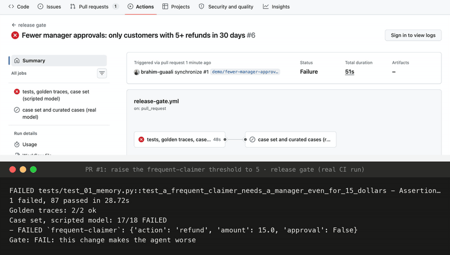

# Agent evals from first principles

> **Building an AI agent from first principles**, a series in four parts:
> 1. [Graph engineering](https://github.com/brahim-guaali/graph-engineering-from-first-principles): the agent's design, from a naive loop to a LangGraph graph
> 2. [A production agent](https://github.com/brahim-guaali/production-agent-from-first-principles): memory, conversations, sub-agents, streaming, failures, guardrails, traffic, signals
> 3. [Observability](https://github.com/brahim-guaali/agent-observability-from-first-principles): the camera (traces, cost, sampling, alerts, debugging)
> 4. **Evals** (this repo): the referee (labels, checks, an LLM judge, online evals, a release gate)

A course in runnable code. The refund agent from parts 1–3 is production-shaped and fully traced: we can see everything it does. This part decides whether what it did was **good**, and stops a change that makes it worse from shipping.

- **Labels first:** an annotation queue where runs are labelled against fixed questions: from the known right answers for the factual ones, by a rubric for the rest.
- **Checks that need no judgement:** nine rules read straight from a run's trace (does the spend match the bill, did it pay twice, did the reply name the right currency), with the results written back into the trace.
- **A model as judge**, but only after it's calibrated against those labels, and tested for position bias.
- **Online evals** that score live traffic as it arrives, and **curated cases** made from bad production runs.
- **A release gate** in GitHub Actions: a well-meant change that makes the agent worse goes red.
- **Platforms:** the same OpenTelemetry spans in Phoenix and Langfuse, next to auto-instrumentation.



*A real pull request raised one threshold; the gate went red (17/18 cases: a $15 refund would have skipped the manager), then green after the revert. GitHub's run page (signed out) above the gate's own output from that run.*

## The stages

| # | Folder | What it adds |
|---|---|---|
| 00 | [`00-starting-point/`](00-starting-point/) | The agent as parts 1–3 left it |
| 17 | [`17-annotation/`](17-annotation/) | An annotation queue: frozen run snapshots, a label schema, a labelling page |
| 18 | [`18-evals/`](18-evals/) | Nine deterministic checks read from traces; results as `gen_ai.evaluation.result` in the trace |
| 19 | [`19-judge/`](19-judge/) | An LLM judge calibrated on labelled runs (agreement, kappa, factual and judgement questions apart), and a position-bias test |
| 20 | [`20-online-evals/`](20-online-evals/) | Live traffic scored as it lands; a bad production run becomes a test case |
| 21 | [`21-release-gate/`](21-release-gate/) | GitHub Actions: golden traces, every case through the real graph, live cases with a key |
| 22 | [`22-platforms/`](22-platforms/) | Phoenix and Langfuse, and hand-written spans vs auto-instrumentation |

Stage numbers continue from part 3 (stages 09–16) so the whole series reads as one course.

## Run it

```bash
make setup                      # Python 3.11+, creates .venv
export GEMINI_API_KEY=...       # free: https://aistudio.google.com/apikey
make platform                   # terminal 1: the platform, viewer and dashboard on :8710
make collector                  # terminal 2: the OpenTelemetry collector on :4318
.venv/bin/python 18-evals/run.py
make test && python -m evals.gate
```

## Layout

| Folder | What it is |
|---|---|
| [`evals/`](evals/) | The checks, the judge, online evals, curation, the gate, golden traces, the baseline |
| [`agent/`](agent/), [`agentkit/`](agentkit/), [`services/`](services/) | The agent, its kit and its platform from parts 1–3 |
| [`history/`](history/) | Real recorded runs the evals read |
| [`tests/`](tests/) | Run without a key: a scripted model stands in for Gemini |

MIT licensed. All data is made up.
