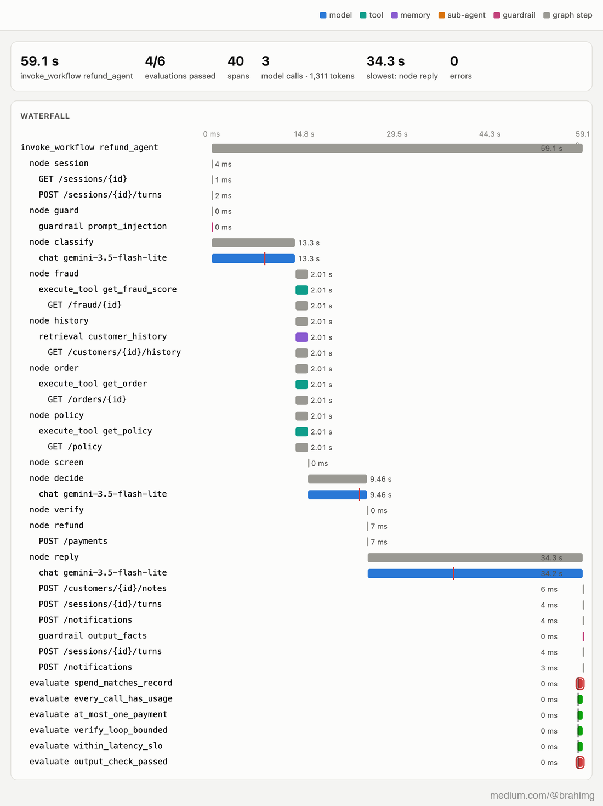
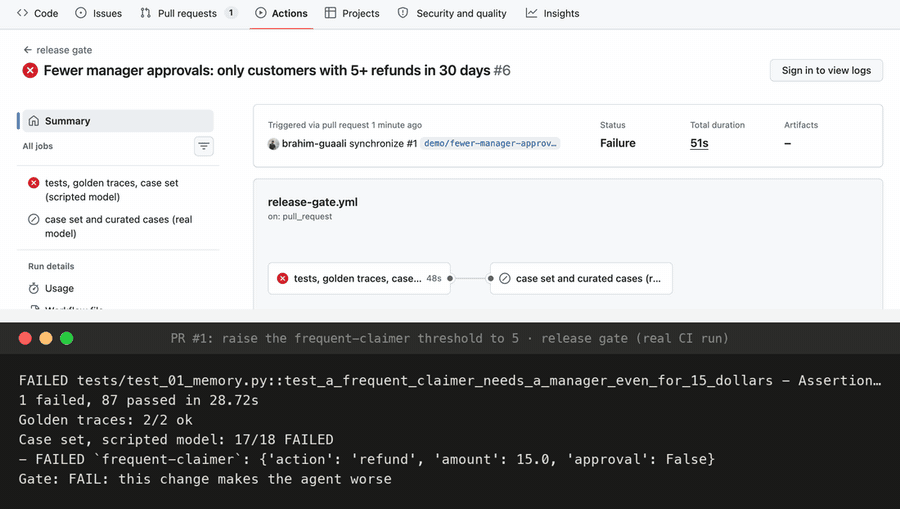

# Your AI agent needs a referee, not better prompts

*Part 4 of 4 in **Building an AI agent from first principles**. [Part 1](https://medium.com/@brahimg/i-rebuilt-one-ai-agent-seven-times-to-understand-graph-engineering-80b9983cd921) built a refund agent as a graph, [part 2](https://medium.com/@brahimg/an-ai-agent-can-be-right-every-time-and-still-not-be-ready-for-production-12ff3bc4fc4b) took it to production and [part 3](https://medium.com/@brahimg/i-stopped-guessing-why-my-ai-agent-was-slow-and-expensive-865ca6f5e18e) gave it a camera. This part decides whether what the camera sees is any good. Real model, real code, real numbers; every image comes from a recorded run.*

---

At the end of part 3 I could see everything my refund agent did: every model call, tool call and sub-agent as a span, what each run cost, when it drifted, and any run replayed from a checkpoint. I still couldn't say whether a run was *good*. A refusal can look correct and be wrong. A reply can sound right and invent a reason. A prompt change can be cheaper and quietly break a rule.

Observability is the camera. Evals are the referee. This part builds one, in six stages, on the same agent: **[github.com/brahim-guaali/agent-evals-from-first-principles](https://github.com/brahim-guaali/agent-evals-from-first-principles)**

## 1. The rules that need no judgement

Some things are certain from the trace alone: a run paid at most once, nothing was paid after a failed lookup, the verify loop stopped within three tries, every model call that got an answer recorded its tokens, the spend in the trace matches the bill. Checking them is just code, a function of the run's spans.

Because they read traces, they work on every run ever recorded, without running the agent again. I ran nine of them on the 75 runs archived from part 3 (the real model on generated customer traffic). The OpenTelemetry GenAI conventions have an event for the result (`gen_ai.evaluation.result`), so each verdict went back into the trace it judged:

*A real run with the checks that applied written back into its trace: four passed, two failed.*

What the referee found:

- **43 older traces predated the cost attribute.** It only arrived halfway through part 3, so those traces added up to $0 against the spend their runs reported. The check caught a tracing gap, not a billing problem: a trace that can't explain the spend it reports can't be used to audit it.
- **6 replies in the wrong currency, counted**: riyals in Arabic replies, and once AED in an English one. The output guardrail had already flagged each of them at run time; the check turns them into a number per run.
- **17 runs over the 60-second target.**
- **My first version of a check was wrong.** "Every model call has token counts" failed 16 runs: calls the budget meter had refused have no tokens to record. A check needs the same care as the code it checks.

And the case set, run on the real model as a test: 18 out of 18 correct.

## 2. Labels, and a judge that reads like them

Code can check amounts and counts. It can't read. Is "your refund arrives in 3 to 5 days" grounded in the FAQ? Was a refusal explained kindly? That takes judgement, and a model can give it for every run, but only once it's been measured against runs whose right answers are known.

So the platform got an annotation queue: thirty runs on the real model, each queued with a reason (a sample of traffic, every guardrail flag, every hand-written case) and frozen as the reviewer would see them. Four questions each: is the decision right, are the amount and currency right, does the reply say only what the facts support, how does it read.

How the labels were made matters, so here it is plainly. **The factual questions were labelled from the known right answers**: every run is a test case or a variant of one, with its expected decision on record. **Grounding and tone were labelled by a second model (Claude) with a written rubric**, in one pass before the judge (Gemini) ran. Nobody labelled by hand. Model-against-model agreement is weaker evidence than a person's labels; a person-labelled set is the next step.

The labels found something none of the code checks could: **26 of 30 replies said things nobody had told them.** 17 refund replies promised the money "in 3 to 5 business days"; the FAQ says 5 to 10 working days. The reply prompt never sees the FAQ, so it wrote what refund emails usually say. Every decision behind those replies was right.

Then the judge, on the same 30 runs:

| question | labels from | agreement | kappa |
|---|---|---|---|
| decision correct | known right answers | 29/30 | n/a (every label is yes) |
| amount and currency right | known right answers | 30/30 | 1.00 |
| reply grounded | second model, rubric | 22/30 | 0.37 |
| tone | second model, rubric | 25/30 | |

The 73% on grounding is agreement with another model's labels, not with people's. On facts it's reliable. Its one "wrong decision" was a gap in what it was shown: a refund that a manager had approved, recorded under the wrong clause. On grounding, it caught every "3 to 5 business days" and let through every "your credit is ready right now" (the FAQ says within an hour), which the labelling model's rubric counts as ungrounded. Which reading is right is a policy question, and it belongs in the judge's prompt. Swapping the order of two replies never changed its pick (no position bias in 12 pairs), but it preferred the longer reply 11 times out of 12.

## 3. The referee on the field

A batch after the fact isn't enough. An online evaluator now follows the trace viewer and scores every run as it lands. Replaying 150 runs drawn from the 75-run archive as if they were live, three a second, the first score came 1 second after the first run, and all 150 within 54 seconds. Each score is also a metric a dashboard can draw and an alert can watch.

Then the other direction: a failure production found should **become a case**. The Arabic reply naming riyals showed up again in a fresh run on the real model and was flagged. A trace doesn't hold the customer's words (message bodies are off, part 3), so the case was built from the platform's own records: the message, the order as it was, and the expectation: refund $55 (the case's known answer), dollars only.

Then the case against both reply prompts, five replies each:

| reply prompt | replies that failed |
|---|---|
| v1, the original | **5 of 5** |
| v2, the fix from part 3 | **0 of 5** |

Part 3's A/B test (60 runs, simulated customers) couldn't prove that fix: one slip in 29 runs against none in 31, p = 0.30. A curated case aimed at the one place it goes wrong proved it in ten calls. Today's default reply prompt is v3: v2's currency rule plus the FAQ entry for each decision, the fix for the timelines the labels found.

## 4. The gate

Every check so far runs *after* something ships. A release gate runs before: on every pull request, GitHub Actions runs the referee, cheapest layer first:

1. **Golden traces**: the deterministic checks on stored recorded runs. Catches instrumentation that broke.
2. **The case set with a scripted model**: all 18 cases through the real graph, platform and verifier, with a model that always gives the right judgments. The model is fixed, so only the *code* can be the cause.
3. **The case set and curated cases on the real model**, against a stored baseline. Catches prompt and model changes.

To see it work, a real pull request: "Fewer manager approvals: only customers with 5+ refunds in 30 days". Managers are busy, the threshold goes from 3 to 5. It reads like a reasonable tweak. The policy still says three.

*The real CI runs of that pull request: red, then green after the revert.*

A customer with four refunds this month would have had $15 refunded without a manager seeing it. The gate went red on the case `frequent-claimer`. Reverting turned it green, and the PR was closed unmerged.

The first CI run also found a flaky test: the race test from part 2 (two runs, one order, same moment) passed on my laptop every time and failed on GitHub's slower runner, where the second run sometimes read the history *after* the first had paid and refused instead. Both outcomes are right; the test had assumed one. It now asserts what matters: exactly one payment.

## 5. And the platforms

Everything here is hand-built so each piece can be seen. Most teams start from a platform and an auto-instrumentation library that patches LangGraph and the model SDK with one line each. I ran the same refund both ways, on the same viewer.

Auto-instrumentation recorded all 6 model calls with their tokens, and every node's input and output. And **none of the model calls were in the run**: the graph's 16 spans formed one trace, the 6 Gemini calls came out as 6 separate traces with no parent. The LangChain instrumentor deliberately doesn't make its spans the current context, so the Gemini one has nothing to attach to. Two libraries that each work, combined, gave a broken trace. What was missing besides: the decision, the policy clause, the payment, the guardrail verdicts, the cost, that fraud review is a sub-agent. Those come from code that knows what the agent is for. Sending the same spans to Phoenix and Langfuse is the next step; I haven't run it yet.

## What I'd tell myself

1. **Start with checks that need no judgement.** They're cheap, exact, and run on every trace you ever kept.
2. **Write the verdict into the trace**, next to what it judged.
3. **Test your checks.** A wrong check fails runs that were fine, and people stop reading it.
4. **Calibrate a judge against labelled runs** before trusting it, question by question, and say where the labels came from. Known right answers are strong evidence; another model's opinion is weak.
5. **Turn every production failure into a case.** A curated case proves in ten calls what an A/B test can't in sixty.
6. **Gate pull requests in layers**, cheapest first, with a fixed model so the code can be blamed alone.
7. **With auto-instrumentation, check the tree first.** Is each run one trace?

Four parts in: a loop with no guarantees, a graph that has them, an agent that survives production, a camera, and a referee that judges every change before it ships. The camera says what happened. The referee says whether it was good.

*Built on personal time with made-up data; it isn't based on any employer's systems.*

---

**The series**, *Building an AI agent from first principles*:
1. [Part 1, graph engineering](https://medium.com/@brahimg/i-rebuilt-one-ai-agent-seven-times-to-understand-graph-engineering-80b9983cd921): from a naive loop to a graph ([code](https://github.com/brahim-guaali/graph-engineering-from-first-principles))
2. Part 2, a production agent: memory, sub-agents, streaming, failures, traffic ([code](https://github.com/brahim-guaali/production-agent-from-first-principles))
3. Part 3, observability: the camera ([code](https://github.com/brahim-guaali/agent-observability-from-first-principles))
4. **Part 4, evals: the referee** (this article, [code](https://github.com/brahim-guaali/agent-evals-from-first-principles))
